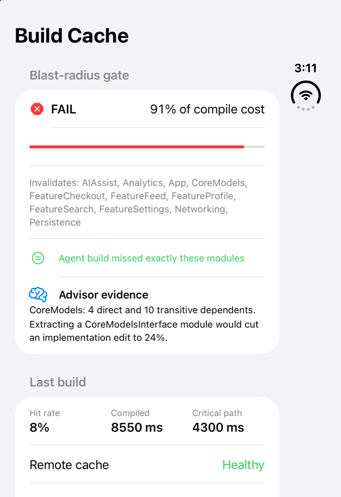
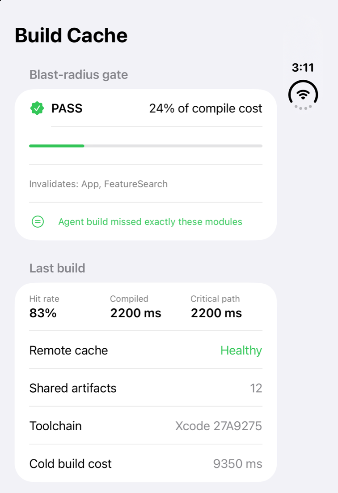
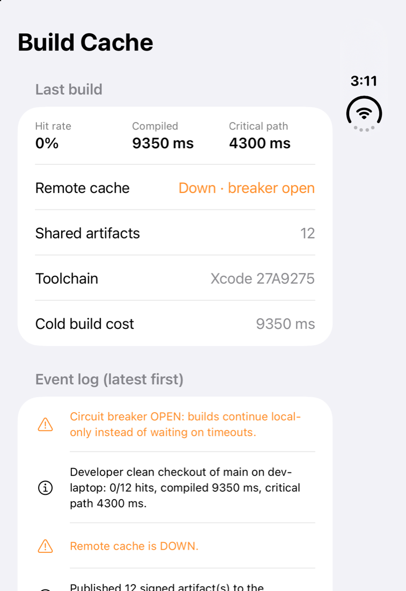
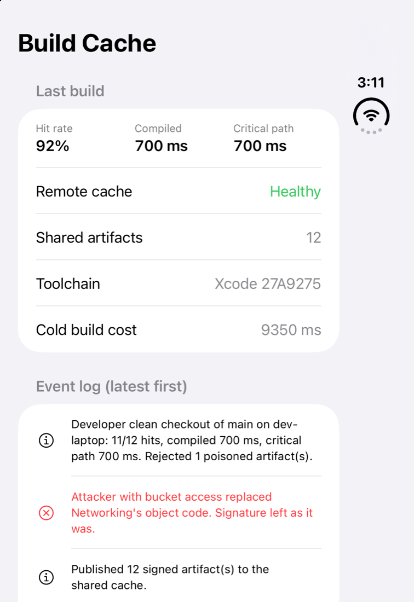
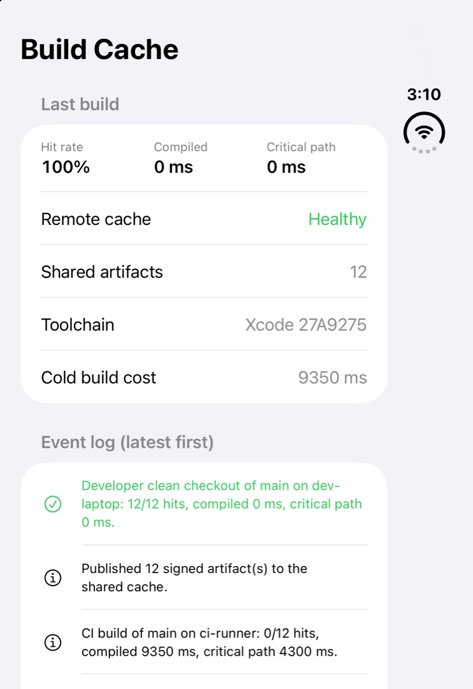
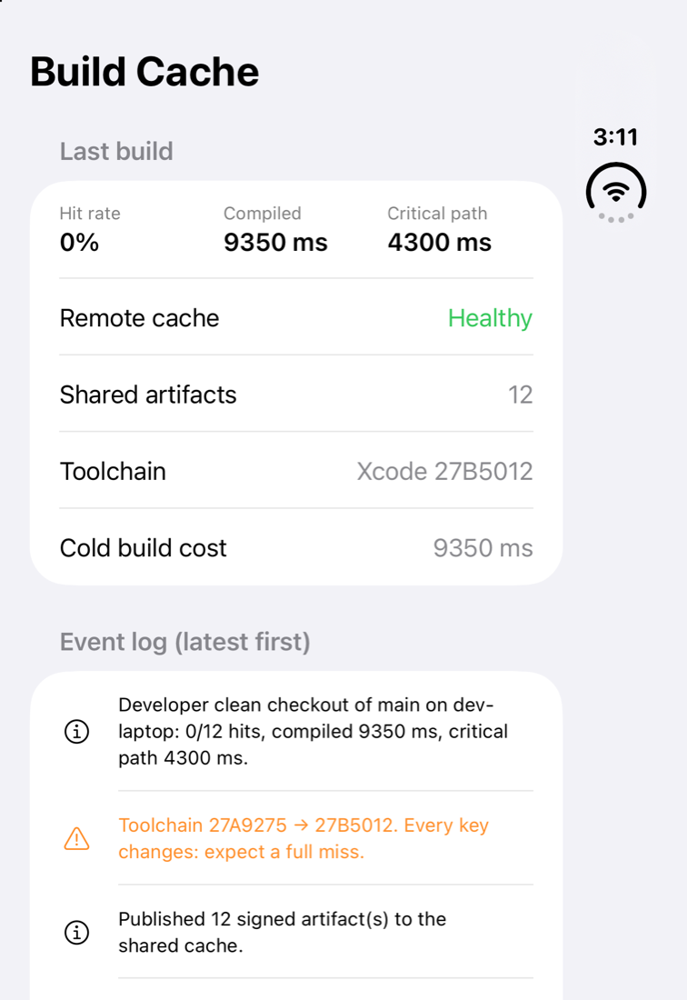
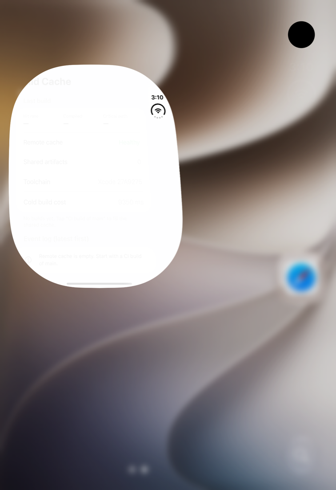

# Build Cache Console: an agent PR that edits `CoreModels` costs 91% of the build. Watch the gate catch it.

**A SwiftUI demo for [BuildCache](https://github.com/rajatslakhina/build-cache-telemetry-kit).** Three simulated machines share one remote compilation cache: a CI runner that signs and publishes, a developer laptop, and a coding agent's sandbox. You can fill the cache, let an agent open a PR, take the cache down, poison an artifact in the bucket, or bump Xcode, and see the effect on every module.



## Why this matters

When agents write most of the PRs, a team's build bill depends on *where* they edit, not on how many lines they change. A one-line change to a foundational module rebuilds 11 of 12 modules for every engineer and every CI runner. This app makes that cost visible and shows the controls a lead needs around a shared cache:

| You do | You see |
|---|---|
| **CI build of main** | 0/12 hits, 9350 ms compiled, 12 signed artifacts published |
| **Developer clean checkout of main** | 12/12 remote hits, 0 ms compiled, on a different checkout path (flags are remapped to `$SRCROOT`) |
| **Agent PR edits FeatureSearch** | Gate **PASS** at 24%; the sandbox misses exactly FeatureSearch and App |
| **Agent PR edits CoreModels** | Gate **FAIL** at 91%; observed misses match the prediction exactly; the advisor shows that extracting a `CoreModelsInterface` module would cut an implementation edit to 24% |
| **Take remote cache down** | After 3 failures the circuit breaker opens and builds continue local-only; **Advance clock 30 s** lets one probe through |
| **Poison Networking in the bucket** | A developer checkout rejects the tampered artifact and recompiles only Networking (700 ms); the next CI build repairs the cache |
| **Bump Xcode point release** | Every key changes: 0% hits, a full 9350 ms rebuild |

| Leaf edit passes | Outage: breaker open | Poisoned artifact rejected |
|---|---|---|
|  |  |  |

| Warm checkout | Toolchain bump | First launch |
|---|---|---|
|  |  |  |

*Screenshots are real `simctl io screenshot` captures from an **iPhone Duo** simulator (iOS 27.1). That was the only device type the installed runtime would create, so the app renders on the Duo's cover display, and the clock and Wi-Fi glyph at the top right belong to that display.*

## How it's built

The app owns the policy and the library supplies the mechanism. `Demo/DemoApp.swift` defines the 12-module monorepo (costs, dependencies), the toolchains, the CI signing key, and the 35% blast-radius budget, then hands them to `BuildCacheConsoleView` from the `BuildCacheUI` product. Every number on screen comes from the real `BuildCache` types: `KeyDeriver`, `TieredCache`, `CircuitBreaker`, `BlastRadiusGate` and `RefactorAdvisor`.

The library is a **remote Swift package**, `XCRemoteSwiftPackageReference` → `https://github.com/rajatslakhina/build-cache-telemetry-kit`, *up to next major* from `1.0.0`. It is not a local path or a branch.

## How to run it

1. `git clone https://github.com/rajatslakhina/build-cache-telemetry-demo-app.git`
2. Open `Demo.xcodeproj`. Xcode resolves BuildCache 1.0.0 from GitHub.
3. Select the **Demo** scheme and any iOS 17+ Simulator, then **Run**.
4. Tap **CI build of main** first, then try the other machines.

Optional scripted walkthroughs (the same code paths the buttons call), used for the screenshots:

```bash
xcrun simctl launch <device> com.rajatlakhina.BuildCacheDemo -tour core-edit
# tours: warm, leaf-edit, core-edit, poison, outage, toolchain
```

You can also add `-tour core-edit` under *Scheme → Run → Arguments*.

## Verification: what actually happened

- **Package resolved from GitHub:** Xcode 27.1 resolved `build-cache-telemetry-kit` **1.0.0** (commit `56aa2e4`) from GitHub. The resulting `Package.resolved` is committed under `Demo.xcodeproj/project.xcworkspace/xcshareddata/swiftpm/`, and the builds below use `-onlyUsePackageVersionsFromResolvedFile`, so nothing floats.
- **Built for the iOS Simulator locally:** `xcodebuild build -scheme Demo -destination 'generic/platform=iOS Simulator'` with Xcode 27.1: **BUILD SUCCEEDED**.
- **Ran on a Simulator:** yes, locally, using that GitHub-resolved build. It ran on a dedicated simulator and was installed and launched with `xcrun simctl`. It was driven by the `-tour` launch arguments above, **not by taps**. Computer-use clicks were avoided because the same Simulator app had the owner's own device open. The app was launched 7 times (once with no argument, plus the 6 tours). The process was still running after each launch, and no crash report was written. Every screenshot above comes from those launches.
- **GitHub Actions** ([workflow runs](https://github.com/rajatslakhina/build-cache-telemetry-demo-app/actions/workflows/ci.yml)): the job runs on `macos-15` with Xcode 16.4 (16F6). It resolves `build-cache-telemetry-kit` **1.0.0** from GitHub using the committed `Package.resolved` (`-onlyUsePackageVersionsFromResolvedFile`), then builds the app for `generic/platform=iOS Simulator`: **BUILD SUCCEEDED**. Its only notice is App Intents' "metadata extraction skipped". The job compiles the app; it does not launch it.

## Related

- Library, design decisions and tests: **[build-cache-telemetry-kit](https://github.com/rajatslakhina/build-cache-telemetry-kit)**

MIT License.
